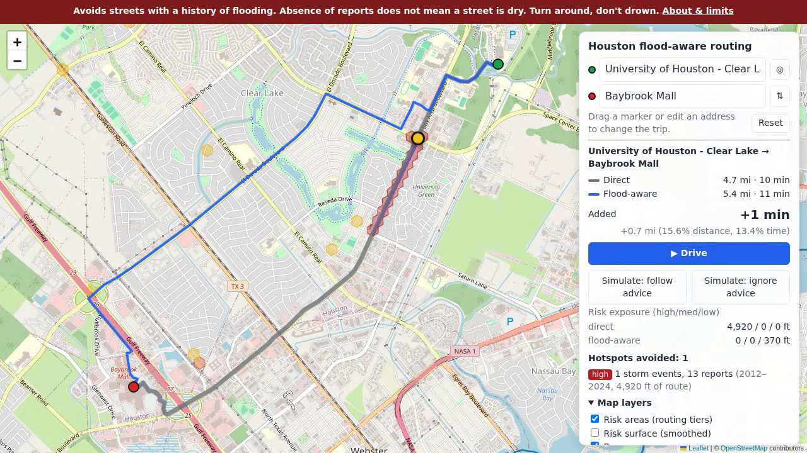

# floodroutes: Houston flood-aware routing

**Driving directions that avoid Houston streets with a history of flooding, and warn you by voice before you reach one.** Built from 15 years of City of Houston 311 reports and firefighter accounts of where their trucks meet water.

*Houston Hackathon 2026.*

- 🌐 **Try it now (any phone or desktop browser, no install):** https://floodroutes.nbolt.com/
- 🎬 **Demo video:** *(link coming)*
- 📄 **About & limits:** https://floodroutes.nbolt.com/about



**How it works**
1. **History:** 5.6 million Houston 311 cases (2011 to today, plus the Harvey extract) are downloaded and classified; 163,000 of them describe street flooding or drainage failure.
2. **Where it recurs:** reports are placed on a hexagon grid and scored by how many separate storms flooded each spot, plus 26 locations firefighters named in a 2018 Rice/Kinder survey of the Houston Fire Department.
3. **Routing:** an open-source routing engine (GraphHopper, on OpenStreetMap roads) gives risky streets a lower priority, so it picks the nearby parallel street. On a typical trip this costs about **30 seconds**, and about 80% of routes that would cross a high-risk area avoid them entirely.
4. **Driving:** ▶ Drive follows your GPS, re-routes, and speaks warnings ("High flood-risk area ahead in 1,200 feet. Flooded in 5 storms.").
5. **Live reports:** drivers tap 🌊 Water on road / ⛔ Impassable / ✓ Water gone; two phones reporting "Impassable" close the road for everyone else's route until the reports expire.

Everything is open: public data, open-source tools, one server, Apache-2.0 license ([LICENSE](LICENSE)). The technical details follow.

> *Avoids streets with a history of flooding. Absence of reports does not mean a street is dry. Turn around, don't drown.*

---

A routing server for Houston that steers drivers away from streets with a history of flooding and drainage problems. The history comes from the City of Houston 311 archive (2011–present plus the Harvey extract).

For each trip it returns two routes side by side:
- **`car`**: the normal car route.
- **`car_flood`**: the same car profile, with road priority lowered inside historical flood hotspots.

The flood data only lowers priority; it never removes a road.

**Map page:** https://floodroutes.nbolt.com/ (public; see `/about` for limits); also http://127.0.0.1:8086/ on quad.
- **Trip:** From/To address search, ◎ my location, draggable markers.
- **Layers:** routing risk areas, smoothed risk surface, bayous, firefighter reports.
- **Phones:** the trip box sits at the top and results in a bottom sheet. With location permission already granted, the start defaults to My location.
- **▶ Drive:** follows the GPS position and keeps the screen awake. It re-routes when off the route by more than ~50 m, or every 20 s, and shows remaining time and distance plus the next flood-history area ahead.
- **Live flood reports from app users:**
  - reporting: 🌊 Water on road / ⛔ Impassable / ✓ Water gone, in the drive card, or "Report at my location" on phones;
  - handling: snapped to the nearest road, grouped into spots, applied to the flood-aware route (water = strong penalty; impassable from one device = strong penalty; from two devices within 30 min = closed; two "Water gone" = cleared);
  - reports expire after 2–3 h;
  - shown in the "Live flood reports" layer, and announced by voice when ahead.

  Stored: road point, kind, time, GPS accuracy, hashed device token; nothing else. Rules in `api/live_config.yaml`. From quad, `deploy/gitano/clear-reports.sh [list | near LAT LON]` lists or clears the public site's reports (with no argument, clears all: handy between demo rehearsals).
- **Voice alerts** (browser speech, no network; 🔊/🔇 in the drive card, remembered):
  - "Flood-aware route. Watch for water. Turn around, don't drown." at the start;
  - medium/high flood-history areas on the road being driven, about a quarter mile ahead ("High flood-risk area ahead in 1,200 feet. Flooded in 5 storms.") and on entry;
  - "Route updated." and "You have arrived."

  Low-tier areas are silent. Each area is announced once per drive.
- **Simulate drive** (desktop only; hidden on phones, where `sim=` links still work): two modes, each at 4/8/16×, with a dotted trail of where the car has been. "Ignore advice" is disabled when both routes are identical.
  - **follow advice:** the car drives the blue flood-aware route.
  - **ignore advice:** the car drives the grey direct route. Each time it leaves the blue route, the app re-plans from the car's position (at most every 3 s) and counts the re-plans. Warnings describe the road actually being driven.
- **Deep links:** `/?from=lat,lon&to=lat,lon[&fromLabel=&toLabel=]`, `view=lat,lon,zoom`, `surface=1`, `sim=1` (simulated drive, following advice) or `sim=ignore` (simulated driver ignoring advice).

> *Avoids streets with a history of flooding. Absence of reports does not mean a street is dry. Turn around, don't drown.*

## How the flood-aware route decides

**Headline: avoiding Houston's flood history costs about half a minute on a typical trip.** Over 200 random city trips:
- median +27–40 s (+2–3%) across runs, with 90% under about +2½ minutes and none more than 50% longer (the upper end is after adding firefighter-reported locations);
- about 80% of the trips whose normal route crosses a high-risk area avoid high-risk areas entirely on the flood-aware route.

**Why detours are small**
1. **Hotspots are small and the street grid is dense.** A high-risk hex is ~130 m across and 0.7% of the city is high risk. There is almost always a parallel street a block away, so going around usually costs tens of metres and tens of seconds.
2. **The router adds only as much time as it must.** Inside a risk tier, a road segment's *priority* is multiplied by 0.05 (high), 0.25 (medium) or 0.6 (low). A high-risk segment therefore "costs" 20× its normal value: a 100 m flooded stretch weighs as much as ~2 km of ordinary road. The router takes any detour cheaper than that, choosing the one that adds the least time.
3. **Reported times are honest dry-road times.** The penalty changes which roads are *chosen*, never the speed assumed on them. "+23 s" is what the detour costs on a normal day. On a flood day the direct route may be crawling or impassable, so the real benefit is larger.
4. **History never closes a road.** If the only way across is, say, a bayou bridge with the next crossing 2 km away, the router accepts the hotspot rather than send the driver on a long detour. Two of the six validation hotspot trips behave this way, by design (`docs/validation.md`). Closing roads is the job of live data (`POST /route` `areas`: gauges, TranStar sensors), which are hard exclusions.

**How it's built**
- **Profiles:** each profile is a stack of GraphHopper "custom models".
  - `car` is GraphHopper's built-in `car.json`: roads a car may not use get priority 0; speed is each segment's average car speed derived from OSM tags at import; and `distance_influence: 90` adds 90 s of cost per km, so near-ties go to the shorter route. That is why a few detours show *negative* added time with positive added distance.
  - `car_flood` is `car.json` plus `flood_risk.json`: three rules on the per-segment `flood_risk` value (0–3), which the import plugin stores by testing each segment's geometry against the risk-tier polygons.
- **Speed-ups:** two precomputations, each suited to one profile.
  - **CH (Contraction Hierarchies)** ranks junctions by importance and adds ~900k shortcut edges, so a `car` query touches a few hundred junctions (~4 ms). But the costs are baked into the shortcuts, so CH can't serve a profile whose costs change per request.
  - **LM (Landmarks)** precomputes costs to and from 16 landmark points and uses them as lower bounds to steer an A* search (~16 ms for `car_flood`). The bounds stay valid whenever costs only go *up*, as flood penalties and live exclusions do. So `car_flood` reuses `car`'s landmarks and accepts per-request live areas; those requests must send `ch.disable=true` (the API does).

**Tuning: a policy choice, not a technical one.** For a more cautious flood route, change `risk/config.yaml` and run `graphhopper/rebuild.sh`:
- stronger multipliers (e.g. high 0.01 = ×100);
- a lower `thresholds.low` (more of the city counts as risky);
- extending risk along whole street segments rather than just the reported blocks.

Each makes detours longer and more frequent. How much delay drivers will accept for how much avoided risk is best set with city staff.

## Pipeline

```
311 index page ──download.py──▶ data/raw/*.txt (timestamped, SHA-256 manifest)
                 ──load.py────▶ raw.service_request_line (text) ─▶ core.service_request (typed, 5.6M cases)
                 ──classify.py▶ core.flood_signal (strong/moderate/weak) + core.storm_event
                 ──geocode.py─▶ core.service_request.geom (source point / Census / failed)
                 ──build_risk.py▶ core.risk_hex (H3 res 10) ─▶ core.risk_polygon ─▶ risk/flood_risk_tiers.geojson
                 ──write_custom_model.py▶ graphhopper/custom_models/flood_risk.json (priority rules on flood_risk)
                 ──FloodImport (graphhopper/plugin)▶ graphhopper/graph-cache (car: CH+LM, car_flood: LM; flood_risk per edge)
                 ──api/app.py (FastAPI)──▶ /route, /risk.geojson, web/index.html
```

| Phase | Code | Output / doc |
|---|---|---|
| 0 Recon | `ingest/recon.py`, `recon_report.py` | `docs/recon.md` |
| 1 Ingest | `ingest/download.py`, `parse311.py`, `load.py`, `schema.sql`, `refresh.sh` | `raw.*`, `core.service_request` |
| 2 Classify | `classify/classify.py`, `classify/rules.yaml` | `core.flood_signal`, `docs/classification.md`, `docs/classification_review.md` |
| 3 Geocode | `geocode/geocode.py`, `geocode/report.py` | `docs/geocode_report.md` |
| 4 Risk | `risk/build_risk.py`, `risk/config.yaml` | `risk/flood_risk_tiers.geojson`, `core.risk_polygon` |
| 5 Routing | `graphhopper/config.yml`, `write_custom_model.py`, `plugin/` (flood_risk encoded value), `rebuild.sh` | GraphHopper on :8989 |
| 6 API + map | `api/app.py`, `web/index.html`, `tests/` | :8086 |
| Validation | `validate/validate.py` | `docs/validation.md`, `docs/validation/*.png` |

## Public front end: https://floodroutes.nbolt.com (gitano)

**Public since 2026-09-26, no login.** Map and routing are served from **gitano** (NixOS VPS, 4 cores, 8 GB). The data pipeline stays on quad (Postgres, 311 refresh, classification, geocoding, graph import).

- **NixOS:** `deploy/gitano/floodroutes.nix` is copied to `/etc/nixos/floodroutes.nix` on gitano and imported from `configuration.nix` (gitano's `/etc/nixos` is a local git repo). It defines:
  - GraphHopper (`-Xmx2g`);
  - the API (4 uvicorn workers, no access log);
  - nginx with Let's Encrypt;
  - firewall ports 80/443.
- **nginx in front of the API:**
  - **Rate limits per visitor:** `/route` and `/reverse` 3/s with bursts of 20; `/geocode` 10/s with bursts of 40. Excess gets HTTP 429. Many people behind one shared address (a venue, a newsroom) share the limit.
  - **OpenStreetMap tile cache at `/tiles/`:** tiles are fetched from tile.openstreetmap.org only when viewed (no pre-seeding, per OSM's tile policy), with an identifying User-Agent, honouring OSM's cache headers. Up to 20 GB, 60 days. Visitors' browsers never contact OSM directly.
  - **Private logs:** `/var/log/nginx/floodroutes.log` records the path without the query string and the visitor address truncated to /24 (/48 for IPv6). Typed addresses and GPS positions are never written to disk.
- **About & limits page (`/about`)**, linked from the banner: not for emergency use, data sources and limits, official live links (TranStar, Harris County FWS, ReadyHarris, NWS), credits, contact.
- **Deploy:** `deploy/gitano/deploy.sh` rsyncs only built artifacts to `/srv/floodroutes`: the graph, GeoJSON layers, surface overlay, address index, web pages and API code. The graph is swapped in, so routing is down for a few seconds. `graphhopper/rebuild.sh` runs it at the end (`DEPLOY=0` skips).
- **To require a login again:** add `basicAuthFile = "/var/lib/floodroutes/htpasswd";` to the virtual host. `deploy.sh` keeps that file current from quad's `.env` (`FLOODROUTES_WEB_USER` / `_PASSWORD`).
- **DNS:** `floodroutes CNAME gitano` in the nbolt.com zone.
- **Capacity:** measured ~37 random city trips/s. GraphHopper is the limit.

## Setup (quad)

1. **Dev shell:** `nix develop` gives JDK 21, osmium, osm2pgsql, GDAL, psql and a uv venv built from `pyproject.toml`. It also exports `PGHOST`/`PGPORT`/`PGPASSWORD`, so `psql` connects directly.
2. **Database:** `docker compose up -d` starts `floodroutes-db` (PostGIS 18-3.6) on `127.0.0.1:5442`, database `houston311`, with data in `/new/floodroutes/pgdata`. The password is in `.env` (gitignored); create it with `POSTGRES_PASSWORD=$(openssl rand -hex 24)`.
3. **Services:** `deploy/quad/floodroutes.nix` is the source of truth, copied to `/etc/nixos/floodroutes.nix` and imported from `configuration.nix`. It defines:
   - `floodroutes-refresh.timer`: daily at 23:30
   - `floodroutes-graphhopper.service`: :8989, admin :8990
   - `floodroutes-api.service`: :8086

   After editing it, copy it over and run `sudo nixos-rebuild switch`.
4. **First build from nothing:**
   ```
   python ingest/download.py && python ingest/load.py
   python classify/classify.py --sample
   python geocode/geocode.py --priority 0          # flood signals; the rest: --priority 1 (hours, resumable)
   curl -LO https://download.geofabrik.de/north-america/us/texas-latest.osm.pbf   # into data/osm/
   osmium extract -b -96.2,29.2,-94.7,30.4 --strategy=complete_ways -o data/osm/houston.osm.pbf data/osm/texas-latest.osm.pbf
   graphhopper/rebuild.sh                           # risk surface + custom model + import (~1.5 min)
   ```
5. **From the laptop:** `ssh -L 8086:localhost:8086 quad`, then open http://localhost:8086/.

## Refresh cycle

- **Nightly** (`refresh.sh`, from the systemd timer):
  1. re-download the MTD and current-year YTD extracts, keeping the newest 2 snapshots on disk;
  2. load them (skipped if the SHA-256 is unchanged; newer extracts win per case);
  3. rebuild `core.flood_signal`;
  4. geocode new flood signals.

  Every step is idempotent. A failure sends `/usr/local/bin/alert`.
- **On demand** (`graphhopper/rebuild.sh`): rebuild the risk surface and custom model, compile the import plugin if its sources changed, then reimport the graph through `FloodImport` into a fresh directory and swap it in. Don't use `java -jar … import` directly: the stock importer doesn't know `flood_risk`. A failed import keeps the old graph. It stops and starts the GraphHopper service around the swap, so routing is down for about 90 s.

## Tunable parameters

**The complete as-built reference is [`docs/PARAMETERS.md`](docs/PARAMETERS.md).** It lists every parameter with its current value, location, purpose and what to run after changing it. The sections below describe the main configuration files.

### `classify/rules.yaml` (Phase 2)
| Key | Meaning |
|---|---|
| `text_fields` | Free-text columns searched by the keyword rules. `Title` is excluded: it only ever holds the type name, case number and address. |
| `types.strong` / `moderate` / `keyword_only` / `excluded` | Case-type lists. Excluded types never produce a signal. |
| `keyword_only_strong_tier` | Tier for a keyword-only type with a strong keyword (default `moderate`). |
| `other_type_strong_tier` | Tier for any other type with a strong keyword; `null` disables it (default; ~10% precise in review). |
| `keywords.strong` / `weak` | Python regexes. Weak ditch/drain words need a water word nearby. |
| `keywords.void` | Drop the record ("disregard", "entered in error"). |
| `keywords.demote` | Maintenance-only text (mowing, trash, dropped phones, missing covers, water mains) goes down one tier unless a strong keyword matched. |
| `keywords.negative` | Cancels keyword matches ("flood light", "flood zone"). |
| `storm_days.percentile`, `min_count`, `first_day` | Storm day = daily count of strong+moderate case types ≥ max(percentile, min_count). |
| `storm_days.max_gap_days`, `merge_windows` | Group storm days into events; force-merge windows (Harvey late reports). |
| `sample.per_tier`, `seed`, `max_chars` | Review sample (`docs/classification_sample.csv`; gitignored because it contains redacted free text). |

### `geocode/geocode.py` constants (Phase 3)
- `BBOX`: accepted area.
- `DISAGREE_M = 100`: above this lat/lon vs X/Y distance, X/Y is used and the gap logged.
- `PLACEHOLDER_MIN_N = 2000`, `PLACEHOLDER_MIN_TYPES = 40`: points repeated this often across this many case types are office placeholders (City Hall and two others) and are treated as missing.
- `CENSUS_BATCH = 5000`: records per Census request.

### `risk/config.yaml` (Phases 4–5)
| Key | Default | Meaning |
|---|---|---|
| `h3_resolution` | 10 | ~66 m hex edge, roughly one block face |
| `tier_weights` | 3 / 1.5 / 0.5 | per-signal weight by tier |
| `half_life_years` | 8 | time decay (the city does fix drainage) |
| `as_of` | null | fix the decay date for reproducible builds |
| `recurrence.per_event` | 1.0 | score × (1 + per_event × distinct storm events in the hex) |
| `max_signals_per_hex_day` | 3 | caps duplicate reports of one puddle |
| `thresholds.low/medium/high` | 10 / 25 / 60 | hex score cut-offs; hexes below `low` are dropped |
| `simplify_m` | 10 | polygon simplification tolerance |
| `graphhopper_priority.high/medium/low` | 0.05 / 0.25 / 0.6 | priority multiplier inside each tier |
| `graphhopper_area_mode` | encoded_value | `encoded_value`: tier stored per edge at import (fast); `multipolygon`: one custom-model area per tier checked at query time (~10× slower); `polygon`: one area per polygon |

After changing any of these, run `graphhopper/rebuild.sh`.

### `graphhopper/config.yml`
The GraphHopper 11.0 settings:
- `car` uses CH and LM; `car_flood` uses LM only, sharing car's landmarks via `preparation_profile: car`. That is valid because flood weights are always ≥ car weights.
- `car_flood` requests need `ch.disable: true`. The API sets it.
- `flood_risk` (0 none, 1 low, 2 medium, 3 high) is listed in `graph.encoded_values`. It is set per edge at import by `graphhopper/plugin` (Java: `FloodRiskRegistry`, `FloodRiskParser`, `FloodRiskIndex`, `FloodImport`). The parser tests each edge's own geometry against the tier polygons: the same check custom-model `areas` make at query time, done once. It's a stock `IntEncodedValueImpl`, so the unmodified GraphHopper server loads the graph.
- Heap is `-Xmx4g`, set in the systemd unit and `GH_HEAP` in `rebuild.sh`.

## Address search (self-hosted)

The map's From/To boxes search addresses, streets, places and intersections without any outside service. The index is `data/geocoder.sqlite` (~100 MB), built by `geocode/build_address_index.py` in about a minute from:
- **US Census TIGER/Line 2025 address ranges** for the eight counties the routing graph covers (Harris, Fort Bend, Montgomery, Galveston, Brazoria, Waller, Chambers, Liberty). That's 281k street segments with house-number ranges and ZIPs; addresses are interpolated along the block. The zip files are in `data/external/tiger/`.
- **OpenStreetMap exact address points** (141k), used when one is near the interpolated spot. OSM alone is too sparse: 689 addresses in Meyerland's ZIP and 11 in South Park's.
- **OpenStreetMap named places** (neighbourhoods, universities, hospitals, parks, airports; ~8k).

Queries take about 1 ms, or ~150 ms for "A & B" intersections. Typed addresses and "my location" never leave the server.

`GET /geocode?q=` returns suggestions; `GET /reverse?lat=&lon=` labels a clicked point ("4800 N Braeswood Blvd, 77096", or "near Rice University"). Rebuild the index after refreshing the OSM extract; `deploy.sh` ships it.

## API

- `GET /route?from=lat,lon&to=lat,lon` returns:
  - `baseline` and `flood_aware`: GeoJSON geometry, `distance_m`, `time_s`, and `hotspots_crossed`;
  - `detour`: added metres and seconds, plus percentages;
  - `risk_exposure_m`: metres driven inside each tier, for each route;
  - `hotspots_avoided`: tier, storm events, report count, year range and metres inside.
- `POST /route` takes `{"from": [lat, lon], "to": [lat, lon], "areas": <FeatureCollection>}`. `areas` (Polygon or MultiPolygon, up to 200) are **hard exclusions** (priority 0) on the flood-aware route only. This is the hook for live TranStar, NWS and HCFCD data. Only the fixture in `tests/fixtures/` exists so far.
- `GET /risk.geojson`: the tier polygons.
- `GET /risk_surface.png`, `/risk_surface.json`: the smoothed surface as a map overlay (`risk/surface_overlay.py`: 40 m pixels, 150 m smoothing, Web Mercator rows; regenerated by `rebuild.sh`).
- `GET /bayous.geojson`: major bayou channels from OSM.
- `GET /geocode?q=`, `GET /reverse?lat=&lon=`: address search (see *Address search*).
- `GET /health`

Tests: `python -m pytest tests/ -q` (18 tests; they need GraphHopper running).
- **Routing:** response shape; the flood route never has more high-risk exposure than the direct one; live areas are hard exclusions that leave the direct route alone; the fixture file works; out-of-area points get a 422.
- **Layers:** `/risk.geojson`, `/hfd.geojson` (only published-report fields, valid severities, all inside Houston), `/risk_surface.png` and `.json` (a real PNG with sane bounds), `/bayous.geojson`, and the map page (banner text present, scripts only from cdnjs).
- **Consistency:** every firefighter report a risk area cites exists in `/hfd.geojson`; `/health` reports both services up.
- **Privacy:** no response contains case-number, address, title, description or notes fields; and a source guard fails if `api/app.py` ever mentions the 311 tables, their free-text columns, or a database driver. The API only ever reads the aggregate GeoJSON files.

## Privacy

Resident free text (names, phone numbers, emails, account numbers) lives only in the database.
- The API, map, GeoJSON, logs and committed docs contain only aggregates: tiers, scores, report counts, storm-event counts and year ranges.
- The classification review sample is redacted, but it can still contain names in free text, so it is gitignored and stays on quad.

## Results

As of 2026-09-25; see the docs for detail.
- **Data:** 5.59M cases → 163,507 flood signals (36.5k strong, 118k moderate, 8.9k weak).
- **Storm events:** 25 detected (late Imelda reports merged). Every named flood event is caught. Beryl is correctly absent: 311 shows it as a wind storm (tree, debris and signal requests quadrupled; flooding and drainage requests stayed normal).
- **Geocoding:** 97.7% of flood signals located (target 95%). 3,555 failures have neither a point nor an address, mostly 2011 migration records.
- **Risk surface:** 4,095 polygons (483 high, 1,158 medium, 2,454 low) covering 107 km².
- **200 random city trips** (ranges over three runs; the sample shifts while the background geocoder adds points):
  - median +27–40 s (+2–3% time); none more than 50% longer;
  - of the ~130 trips whose normal route crosses a high-risk area, 76–82% avoid high-risk areas entirely on the flood-aware route;
  - API latency (both routes plus overlay, keep-alive client) median ~22 ms, p99 ~82 ms, after moving flood risk into an encoded value (was ~300 / ~850 ms).
- **Top-10 hotspots:** 6 got a test trip through them and 4 of those are avoided. The two not avoided are by design (no reasonable alternative). The other 4 hotspots sit where short test trips never pass (freeway frontage, cul-de-sacs). See `docs/validation.md`.

## Firefighter-reported flooding

311 records where residents call from. The 2018 HFD officer survey (*Measuring Flooding with the Houston Fire Department*, Perry & Stein, Rice/Kinder, 2019) records where firefighters meet water. The 1,383 surveyed points are unpublished, but Appendix A's officer comments name specific streets.
- **Transcribed:** `risk/hfd_comments.yaml`, 26 place-specific comments with station, quote, streets and severity.
- **Mapped:** `risk/hfd_locations.py` maps them onto OSM roads (intersections, "X from Y to Z" stretches, the road in front of a station). 22 mapped; 4 could not be (listed in its output).
- **In the risk surface:** each location sets a minimum hex score. `cut_off` (units can't leave the station) = 60 (high), `recurring` = 25 (medium), `major_event` = 10 (low); set in `risk/config.yaml` under `hfd_comments`.
- **Effect:** 301 hexes touched, and 294 of them were *raised* above their 311 score. The places firefighters name are almost all under-reported by 311 (e.g. Bay Area Blvd at Saturn Ln to Space Center Blvd in Clear Lake, where Station 72's trucks can't get out).
- **Map:** the "Firefighter reports (2018 HFD survey)" layer shows each location with its quote. Risk areas that include one say so in their tooltip.
- **Independent check:** `docs/hfd_stations.md` compares the stations officers call cut off with the 311-only score around them. About half are in the top quarter of stations; the rest are where 311 misses station-access flooding.

### HFD water-rescue incidents (loaded, not used)

- **Source:** a Rice University GIS account (`dlr10_ricegis`) publishes 2.46M geocoded HFD incidents, 2019 to mid-2025, as the public ArcGIS layer `HFD_FinalSituation_XYTableToPoint`. It appears to belong to a Rice study of HFD false alarms and station workload. It carries no description or license, and it is a research working copy of HFD records, not an official HFD release.
- **Loaded:** `ingest/hfd_incidents.py` pulls the 1,570 flood-related incidents into `core.hfd_flood_incident`: water-rescue dispatches (CAD `FFWR*`) plus swift-water rescue, water evacuation and flood assessment. They are classed as rescue (589), reported but not found (392), assessment (160) and other (429), and linked to `core.storm_event` by day. A raw snapshot is kept in `data/external/hfd_flood_incidents_rice.json`.
- **Not used, for now.** Nothing reads the table: it is not in `risk/build_risk.py`, the map, or the API. Before using it, ask Rice and HFD for permission and for provenance, and check whether rescue points mark the water or the caller.
- **Why it is worth asking about:** 80% of the rescue and reported-but-not-found incidents fall outside every current risk polygon, and only about 260 incidents land on days the 311 data counts as storm days (Jan 9, 2022 had 42 water-rescue dispatches and is not a detected storm).
- **The survey points are still unpublished:** the 1,383 surveyed flood locations behind the 2018 HFD survey are not in any Rice ArcGIS layer (checked 2026-09-26).

## How much of Houston is at risk

Computed by `risk/coverage_stats.py` (2026-09-25). City limits (1,588 km²) and roads (24,285 km drivable) come from the OSM extract.

| Tier | Area | Share of city area | Share of road length |
|---|---:|---:|---:|
| High | 11.1 km² | 0.70% | 0.89% |
| Medium | 27.0 km² | 1.70% | 2.12% |
| Low | 68.1 km² | 4.29% | 5.49% |
| **Any tier** | 106.3 km² | **6.69%** | **8.51%** |

| Road type | km | High | Medium | Low | Any tier |
|---|---:|---:|---:|---:|---:|
| Freeways | 1,542 | 0.15% | 0.58% | 1.72% | 2.5% |
| Major roads | 5,004 | 0.89% | 2.06% | 5.97% | 8.9% |
| Local streets | 7,475 | 1.70% | 4.00% | 9.56% | 15.3% |
| Service roads, driveways and lots | 10,265 | 0.42% | 1.02% | 2.86% | 4.3% |

**Reading these numbers:**
- The tiers mean "floods *repeatedly* and gets *reported* repeatedly". A hex needs a score ≥ 10, in practice reports from more than one storm, so routes don't avoid the whole city.
- The looser measure, "has ever had a flood or drainage report", is much larger: 34,800 hexes covering 587 km², roughly a third of the city (not clipped to city limits).
- History concentrates on neighbourhood streets, where residents call from. Freeways barely register because freeway flooding isn't reported through 311 (TranStar covers it).
- Bayou-side roads with few front doors (e.g. North/South Braeswood west of Hillcroft) are under-reported for the same reason.

**The tiers are local.** Rough rectangles, not official neighbourhood boundaries:

| Area | High | Medium | Low | Any tier |
|---|---:|---:|---:|---:|
| I-10 / Washington wedge (Woodcrest / Camp Logan) | 8.5% | 9.1% | 12.6% | 30.2% |
| Meyerland (Brays Bayou, just outside the Loop) | 3.5% | 7.2% | 9.7% | 20.4% |
| Memorial City | 0.7% | 2.0% | 3.0% | 5.7% |
| Southwest inside the Loop (Braes Heights, West U, Southside Place) | 0.4% | 1.1% | 4.1% | 5.6% |

## Known limitations and next steps

- **Latency (fixed 2026-09-25):**
  - `car_flood` now reads the per-edge `flood_risk` encoded value instead of evaluating polygons per edge: p99 went from 765 ms to 91 ms in GraphHopper.
  - The API also shares one HTTP client; a per-request client cost ~200 ms.
  - On quad, *new* localhost TCP connections sometimes take ~200 ms to connect (seen for both GraphHopper and the API; OpenSnitch's connection interception is the suspect, unconfirmed). Browsers reuse connections, so map users don't see it.
- **Live exclusions** (`POST /route` `areas`) still use query-time areas. That's fine for a handful of polygons; hundreds would bring the old slowness back.
- **Moderate tier precision (~50%):** it is dominated by the `Drainage` type, much of which is ditch maintenance. The event-recurrence factor limits the damage, since dry-day maintenance calls don't recur across storms.
- **To do if the city continues the project:**
  - Weekly graph rebuild on a timer. The nightly refresh already reclassifies and geocodes; history changes slowly.
  - Low-downtime rebuild: import the new graph while the old one keeps serving, then restart (~10 s gap instead of ~90 s).
  - Live gauge feed: HCFCD gauges plus a table of road segments by flood stage (e.g. North/South Braeswood when Brays Bayou leaves its banks), sent as live `areas`. Bayou-side roads have few front doors, so 311 under-reports them.
  - TranStar roadway flood warning sensors (underpasses) as live `areas`.
  - **Heading-up driver view:** during a drive the map already follows the car at street level, but stays north-up. Rotate it so forward is up, using GPS heading while moving or the route direction otherwise, with a north-up toggle. Options: the `leaflet-rotate` plugin (small change), or MapLibre GL (native rotation and tilt), done together with self-hosted vector tiles.
  - Voice reporting ("report flooding") so drivers don't need to touch the phone.
  - **Flood-event scaling** (see [`docs/SCALING.md`](docs/SCALING.md)): stay on gitano day to day; when the National Weather Service issues a flood watch or warning, start extra cloud servers from an image with the built files, behind a load balancer, and scale back to zero afterwards. Prerequisites: vector tiles on a CDN, a shared live-report store, and re-routing on report changes instead of every 20 s.
- **Out of scope (hooks left):** live TranStar high water, NWS storm reports, HCFCD gauges and rainfall, USGS high-water marks (`POST /route` `areas`); OsmAnd/GPX export; public deployment.
