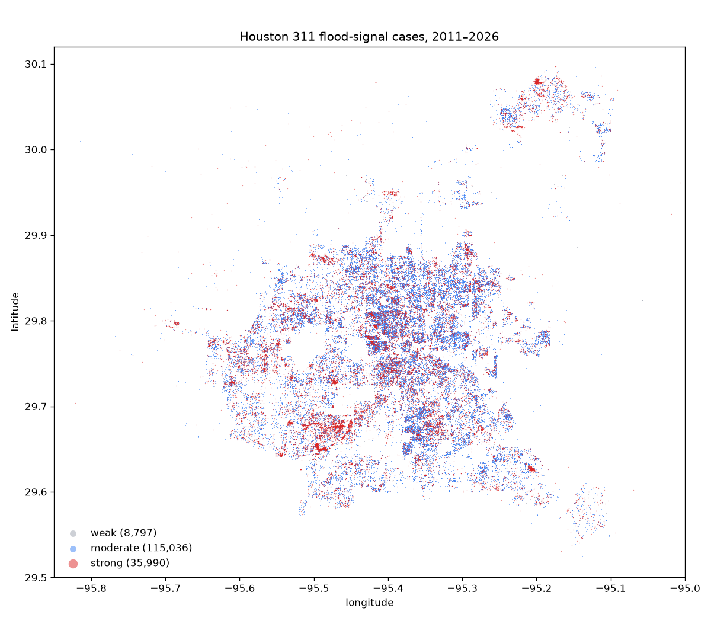

# Phase 3: geocoding report

Generated by `geocode/report.py`. Precision is `source_point` for city-supplied coordinates, `address` for Census batch matches, `failed` otherwise.

## All cases by method and precision

| Method | Precision | Cases |
|---|---|---:|
| source_latlon | source_point | 5,290,619 |
| none | failed | 184,700 |
| source_xy | source_point | 87,030 |
| census_batch | failed | 16,611 |
| census_batch | address | 12,143 |

Lat/lon and X/Y disagreed by > 100 m (X/Y used, logged in `geocode_note`): **14,748** cases.

Placeholder points treated as missing (≥ 2,000 records across ≥ 40 case types): (-95.3698, 29.7584) — 36,960 records, 181 types; (-95.3682, 29.7670) — 6,904 records, 42 types; (-95.3671, 29.7599) — 2,508 records, 123 types.

## Flood-signal cases

| Tier | Cases | source_point | address | failed | Located |
|---|---:|---:|---:|---:|---:|
| strong | 36,544 | 35,979 | 11 | 554 | 98.5% |
| moderate | 118,091 | 115,000 | 36 | 3,055 | 97.4% |
| weak | 8,872 | 8,786 | 11 | 75 | 99.2% |
| **all** | 163,507 | | | | **97.7%** |

Acceptance target: ≥ 95% of flood-signal records at address precision or better (met).

Failures are records with neither a usable source point nor an address: almost all are 2011 records the city migrated without location, or older records with a blank address.

## Failure rate by created year (all cases)

| Year | Cases | Failed | Rate |
|---|---:|---:|---:|
| 2011 | 177,372 | 150,649 | 84.9% |
| 2012 | 225,877 | 6,018 | 2.7% |
| 2013 | 243,589 | 4,276 | 1.8% |
| 2014 | 282,291 | 3,963 | 1.4% |
| 2015 | 328,622 | 1,846 | 0.6% |
| 2016 | 355,271 | 2,235 | 0.6% |
| 2017 | 384,845 | 5,508 | 1.4% |
| 2018 | 416,857 | 3,073 | 0.7% |
| 2019 | 411,787 | 1,857 | 0.5% |
| 2020 | 394,177 | 2,348 | 0.6% |
| 2021 | 381,807 | 6,458 | 1.7% |
| 2022 | 374,430 | 11,912 | 3.2% |
| 2023 | 401,912 | 592 | 0.1% |
| 2024 | 481,111 | 380 | 0.1% |
| 2025 | 445,428 | 115 | 0.0% |
| 2026 | 285,726 | 80 | 0.0% |
| None | 1 | 1 | 100.0% |

## Map preview

