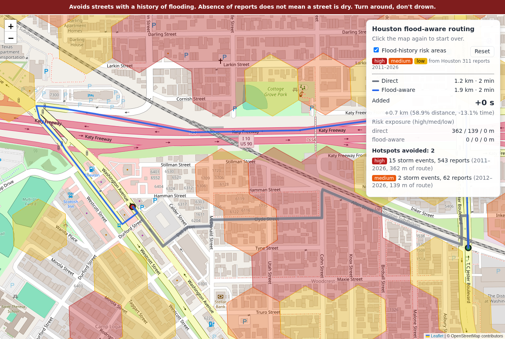

# Validation

Generated by `validate/validate.py` on 2026-09-25 22:55 against the live API.

## Top-10 hotspots

For each of the ten highest-scoring high-tier polygons, the interior point was snapped to its road and trip endpoints were taken 0.7, 1.2 or 2 km out along real roads in four directions (outside the polygon); the first endpoint pair whose baseline route crosses the polygon is used (straight-line pairs as fallback).

| # | Polygon | Score | Storm events | Reports | Baseline crosses | Flood route avoids | Added time | Added distance | Screenshot |
|---:|---|---:|---:|---:|---|---|---:|---:|---|
| 1 | high_0001 | 1480 | 15 | 543 | yes | **yes** | +-17 s (-13.1%) | +723 m (58.9%) | [png](validation/hotspot_01_high_0001.png) |
| 2 | high_0002 | 1159 | 6 | 148 | yes | no | +34 s (47.2%) | +209 m (19.7%) | [png](validation/hotspot_02_high_0002.png) |
| 3 | high_0003 | 1137 | 13 | 91 | yes | **yes** | +83 s (66.9%) | +1724 m (127.1%) | [png](validation/hotspot_03_high_0003.png) |
| 4 | high_0004 | 1063 | 18 | 1122 | yes | no | +40 s (56.3%) | +344 m (34.8%) | [png](validation/hotspot_04_high_0004.png) |
| 5 | high_0005 | 1003 | 6 | 134 | no trip found | – | – | – | – |
| 6 | high_0006 | 910 | 7 | 143 | yes | **yes** | +102 s (141.7%) | +742 m (65.1%) | [png](validation/hotspot_06_high_0006.png) |
| 7 | high_0007 | 622 | 6 | 75 | yes | **yes** | +-14 s (-10.2%) | +449 m (33.4%) | [png](validation/hotspot_07_high_0007.png) |
| 8 | high_0008 | 607 | 8 | 64 | no trip found | – | – | – | – |
| 9 | high_0009 | 537 | 9 | 49 | no trip found | – | – | – | – |
| 10 | high_0010 | 530 | 8 | 37 | no trip found | – | – | – | – |

**4 of 6** hotspot trips avoid the hotspot on the flood-aware route.

How to read this:

- *Not avoided* is by design, not a failure: history only multiplies priority (high = 0.05, i.e. the segment costs ~20x), it never excludes a road. When every alternative is much longer, for example the only bayou crossing or freeway access for kilometres, the route still passes through. Live high-water reports (POST /route `areas`) are the hard-exclusion path.
- *No trip found* means none of the test endpoint pairs produced a baseline through the polygon: typically hotspots on freeway frontage or ramps, or in cul-de-sac networks that through-trips never enter.
- Percentages are large because the test trips are short (1.5–4 km) and local by construction; the absolute costs (+1–3 min) are what a driver sees. See the random-pair section for realistic trips.

### 1. high_0001

## 200 random origin–destination pairs

Origins and destinations are random located 311 case points (so inside the city), ≥ 2 km apart in a straight line. 0 pairs could not be routed.

| Metric | median | p90 | p99 | max |
|---|---:|---:|---:|---:|
| Baseline distance (km) | 20.7 | 35.8 | 53.5 | 66.6 |
| Baseline time (min) | 19.6 | 30.1 | 45.1 | 52.5 |
| Added distance (%) | 1.4 | 9.2 | 24.6 | 39.8 |
| Added time (%) | 2.2 | 11.9 | 26.5 | 45.0 |
| Added time (s) | 20.0 | 136.0 | 287.0 | 290.0 |
| Hotspots avoided | 5.0 | 18.0 | 27.0 | 30.0 |
| API latency, both routes (ms) | 22.4 | 41.9 | 81.6 | 106.1 |

- 31 of 200 trips (16%) are unchanged by the flood profile.
- 128 baseline routes cross a high-tier area; the flood-aware route clears all high-tier exposure on 107 of them.
- Trips where the flood route is > 50% longer: **0**.
- API latency (both GraphHopper calls plus hotspot overlay): median 22 ms, p99 82 ms. Target was < 500 ms per flood route.
